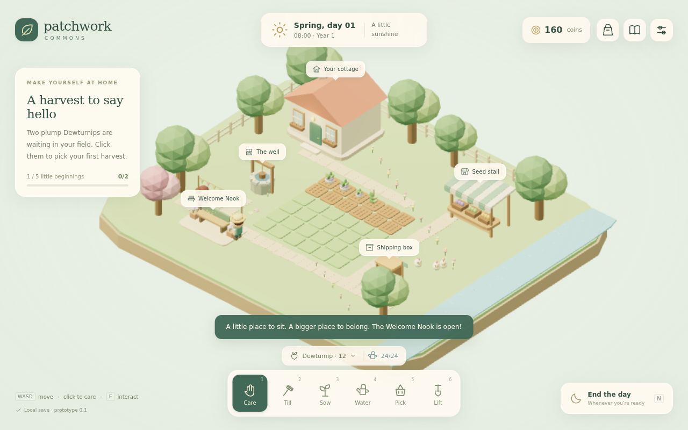

# Patchwork Commons

A small, cozy farming game prototype for the browser, created **out of boredom with the assistance of GPT-6-ASTRA**.

This was a one-off experiment: take a farming-game idea, turn it into something playable, and enjoy the process. GPT-6-ASTRA assisted with the gameplay design, implementation, and iteration.

**The experiment is complete. There is no intention of further development.** This repository preserves the prototype as it was left, along with its source code, screenshots, and design notes.

Repository: [tanm8386/PatchworkCommons](https://github.com/tanm8386/PatchworkCommons)



## About the game

Welcome to **Bellwether Hollow**. You have a little farm, a handful of seeds, and a neighbor named Neri who would like to make a welcoming place for the village.

Plant something, give it a drink, sell a harvest, or share it with the community. The fixed-isometric view, low-poly scenery, pastel colors, and gentle pacing are all part of the experiment.

### What is playable

- A compact 3D farm with a chibi player, cottage, seed stall, well, shipping box, and ambient hens.
- **36 farm plots** and four crops: Dewturnip, Ribbon Bean, Puffradish, and Pearl Oat.
- Tilling, planting, watering, harvesting, bean regrowth, and recovery of unfinished seeds.
- Four seasons, predictable weather, rain watering, and a day/night clock.
- Seed purchases, immediate sales, overnight shipping, and a row-tool upgrade.
- A **Welcome Nook** project with two contribution routes and a visible, persistent result.
- A satchel, farm notebook, forecast, introductory guidance, and crop inspection.
- Local autosaves, JSON save import/export, adjustable day length, reduced ambient motion, and sound controls.

Crops pause when they need care instead of withering, and no time passes while the game is closed. At 22:00, Quiet Time lets you finish at your own pace.

The hens are scenery rather than a functional animal-care system. The larger ideas in the original design notes are a record of the experiment, not a plan for future releases.

## Run locally

### Requirements

- Node.js **22.12 or newer**; Node.js 24 is recommended.
- npm.
- A modern browser with WebGL support.

```bash
git clone https://github.com/tanm8386/PatchworkCommons.git
cd PatchworkCommons
npm ci
npm run dev
```

Open **http://localhost:5173**.

All scene models, interface icons, and interaction sounds are generated locally. No API keys, AI service connection, or account is needed to play. GPT-6-ASTRA was used during creation; it is not a runtime dependency.

## Controls

| Input | Action |
|---|---|
| Left-click a patch | Walk over and use the selected tool |
| Right-click the ground | Walk without using a tool |
| WASD / arrow keys | Move in screen-relative directions |
| E / Space | Interact with a nearby patch or service |
| 1–6 | Select Care, Till, Sow, Water, Pick, or Lift |
| Seed chip above the toolbelt | Choose a crop to plant |
| Shift + click | Tend a row of up to three patches after buying row attachments |
| I | Open the satchel |
| J | Open the farm notebook and its selectable list of patches |
| N | Open the end-of-day panel |
| Escape | Open settings or close a panel |
| Mouse wheel | Adjust zoom |

The default **Care** tool picks, waters, plants, or tills according to the selected patch's state. Click a labeled service to walk over and use it. The well refills your watering can for free.

Basic controller support is included: left stick to move, A/X to interact, bumpers to change tools, Y for the satchel, and Start for the notebook. In panels, use the D-pad to move focus, A to confirm, and B to close. Touch users can use the on-screen controls and the notebook's patch list.

## Build and checks

| Command | Purpose |
|---|---|
| `npm run dev` | Start the Vite development server |
| `npm run build` | Check TypeScript and generate the production build in `dist/` |
| `npm run preview` | Serve the production build locally, normally on port 4173 |
| `npm test` | Run simulation, transaction, save-validation, and navigation tests |
| `npm run test:browser` | Run the Playwright gameplay tests |

To preview a production build:

```bash
npm run build
npm run preview
```

Install Chromium before running browser tests:

```bash
npx playwright install chromium
npm run test:browser
```

On minimal Linux installations, Playwright may also need `npx playwright install-deps chromium`.

The prototype includes **15 simulation/navigation tests** and **6 browser gameplay tests**. They cover planting and growth, shipping and payment, save/reload behavior, purchases, community contributions, mobile notebook interaction, and selecting tall crops. The browser suite uses one worker to limit software-rendering contention.

## Saves

- Your farm is stored in the browser's local storage under `patchwork-commons.farm.v1`.
- The game saves after actions, periodically during play, and when the page exits.
- **Settings → Export save** creates a JSON backup; **Import save** restores a validated backup.
- Saves belong to the current browser and site address. Changing browser, host, or port creates a separate storage location.
- If browser storage is unavailable, the interface reports session-only play and you can still export a save.

## Technology and structure

Built with **TypeScript**, **Three.js**, **Vite**, **Vitest**, and **Playwright**, plus HTML/CSS and the Web Audio API.

```text
src/game/catalog.ts        Crop definitions, calendar, tool and world coordinates
src/game/simulation.ts     Pure gameplay mutations and dawn settlement
src/game/persistence.ts    Save validation, loading, and storage
src/game/navigation.ts     Collision-aware pathfinding and direct movement
src/render/world.ts        Procedural scene, crops, actors, weather, and feedback
src/ui/                    HTML interface and inline SVG icons
src/audio.ts               Gesture-unlocked synthesized interaction sounds
src/main.ts                Input, orchestration, rendering loop, and transitions
src/game/*.test.ts         Simulation and navigation tests
tests/farm.spec.ts         End-to-end browser gameplay tests
docs/                      Screenshots and historical prototype notes
```

The simulation is independent of rendering and the DOM. Static scenery is instanced, and software-rendered WebGL uses a lower rendering budget while the interface stays at native resolution.

The [prototype notes](docs/PROTOTYPE_HANDOFF.md) capture how the experiment was built. Any next-step ideas in those notes are historical; **this project ends with the prototype**.
